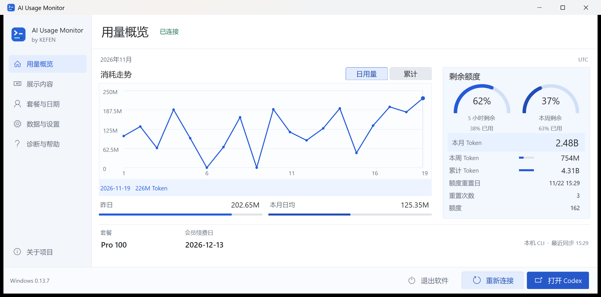
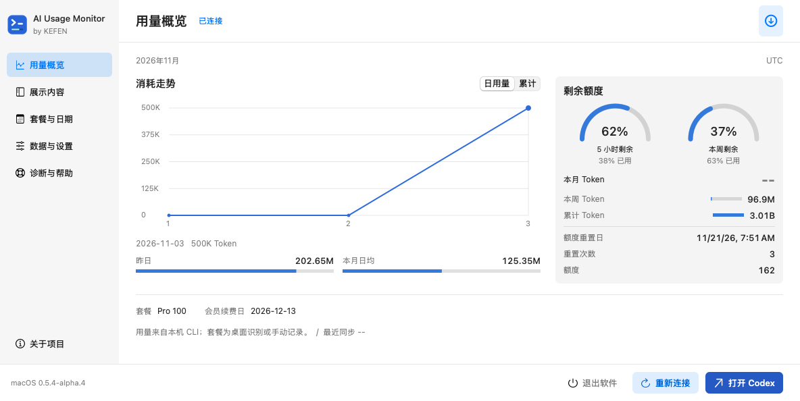

# AI Usage Monitor

by KEFEN

在 Codex 侧边栏看剩余额度和 Token 消耗，不用为了查一个数字打断当前工作。Windows 和 Mac 可查看每日走势、比较本周与本月用量，并记录自己的续费日。Chrome 版独立运行，只显示 ChatGPT 网页实际提供的用量，不读取桌面数据。

An unofficial quota and token usage companion for Codex desktop, with a separate Chrome extension for ChatGPT. Not affiliated with OpenAI. Usage is not an API invoice.

## 下载 Downloads

| 系统 | 安装包 | 安装方式 |
| --- | --- | --- |
| Windows 10 / 11 x64 | [Windows 0.13.7](https://github.com/kefen/AI-Usage-Monitor/releases/tag/windows/v0.13.7) | 下载未签名的 Setup.exe；升级选择原安装目录。 |
| Mac · Apple 芯片 | [Apple Silicon DMG](https://github.com/kefen/AI-Usage-Monitor/releases/download/macos%2Fv0.5.4-alpha.4/AI-Usage-Monitor-macOS-0.5.4-alpha.4-arm64-unsigned-test.dmg) | M 系列芯片；0.5.4-alpha.4，未公证预发布版。 |
| Mac · Intel | [Intel DMG](https://github.com/kefen/AI-Usage-Monitor/releases/download/macos%2Fv0.5.4-alpha.4/AI-Usage-Monitor-macOS-0.5.4-alpha.4-x86_64-unsigned-test.dmg) | Intel 处理器；同一预发布版本。 |
| Chrome | [Chrome 0.5.4](https://github.com/kefen/AI-Usage-Monitor/releases/tag/chrome/v0.5.4) | 解压 ZIP，在扩展管理页选择“加载已解压的扩展程序”；不是商店版。 |

[安装与使用指南](docs/USER-GUIDE.md) · [安全说明](SECURITY.md) · [MIT License](LICENSE)

从旧名称升级，请从上表手动下载一次。Windows 选择原安装目录；Mac 先退出旧版，再将新应用拖入“应用程序”；Chrome 在原扩展目录替换文件并重新加载。

本次安装包已在 GitHub Releases 提供 SHA-256。桌面应用内的签名更新清单暂未切换到本版；请以上表为准。

## 界面 Screenshots

以下为运行界面的示例数据，不代表真实账户额度。

**Windows · 用量概览**：左侧可切换每日与累计消耗，右侧同时显示 5 小时和本周剩余额度。



**macOS · 原生操作面板**：同一窗口查看趋势、套餐和设置，连接操作位于右下角。截图来自 Apple 芯片原生构建。



**Chrome · 网页用量**：只在网页明确提供本月总量时显示月度 Token。


## Before Downloading

### Updates

Click **Check for updates** in **About project**. Desktop builds check at startup
and every six hours while running; this is polling, not real-time push. Only a
verified newer version shows an update icon beside the language selector.
A new version offers background download,
then explicit confirmation to restart the companion and install. Codex itself stays
open. Settings are preserved. Updates use signed, expiring metadata with a pinned
Ed25519 public key plus package SHA-256 verification. Failed verification blocks
installation. Windows uses the existing transactional installer; Mac keeps a backup
app and verifies the new version's native launch acknowledgement. A safe rollback
is attempted if replacement or launch fails; if the new app is still running,
the backup is retained and Diagnostics explains the required action. Runtime crash
recovery after a successful launch is not automatic.

Unpacked Chrome extensions can check and link to a newer release but must be
downloaded, unpacked and reloaded in chrome://extensions; they cannot self-install.
Existing older installations must be upgraded once to gain update support.

在“关于项目”点击“检查更新”；仅发现已验证的新版时，语言选择旁显示更新图标。启动时及运行中每六小时检查，并非实时推送。已是最新版与网络失败会分别提示。桌面端可后台下载，确认后重启本工具安装，保留设置、不关闭 Codex。浏览器手动加载版需下载解压后重新加载。旧版 Mac 更新器失败时，请按安装指南手动替换一次应用。

**Windows:** this unsigned installer may show “Windows protected your PC” and
“Unknown publisher”. Verify the repository download and release SHA-256 first.
Only for that trusted file, choose **More info → Run anyway** if offered.
Do not disable Defender or SmartScreen. Managed computers may prohibit this.
Future code signing identifies the publisher but cannot guarantee immediate trust.

**Mac:** these experimental builds are not notarized. Read the bundled
**READ-ME-FIRST-macOS.html** before opening. Install into Applications first.
If blocked, choose **Done**, not Move to Trash. Go to
**System Settings → Privacy & Security → Open Anyway**, then confirm opening.
The app and bundled Node runtime may need separate approval. Approve only verified
downloads; do not disable Gatekeeper.

Windows：核对来源及校验值后，如系统允许，可选择“更多信息 → 仍要运行”，不要关闭防护。
Mac：被拦截时选择“完成”，不要移到废纸篓；到“系统设置 → 隐私与安全性 → 仍要打开”，再次确认。应用和 Node 可能需分别授权。

### Windows Compatibility

One x64 installer covers Windows 10/11; separate OS-specific packages are not
needed. Prefer a currently supported Windows release. Windows 11 ARM64 requires
a separately built and tested package before native support can be claimed;
none is currently shipped. Windows 7/8 and 32-bit x86 are not supported.

## Features

- Guided setup: environment checks, installation folder, sidebar choices,
  installation and explicit connection.
- Light gray and blue management UI, original terminal logo, regular typography,
  visible version and GitHub link.
- English, Simplified Chinese and Traditional Chinese. Desktop language also
  updates sidebar labels; browser language is independently selectable.
- Five-hour and weekly quota when returned, dated daily Token usage, weekly
  usage, daily average and account lifetime tokens.
- Configurable sidebar items and optional local Codex subscription records.
  This tool does **not** sell memberships, register accounts or change billing.
- Graceful old-panel shutdown, restart consent, diagnostic export and settings
  backup/restore.

## Windows Setup

1. Install and sign in to the official Microsoft Store Codex application.
2. Open Setup as your normal Windows user and follow the four steps.
3. Upgrades default to the detected installation. New installs default to
   `Documents/Codex/Apps/CodexSidebarMeter`. Choosing the same drive as Codex
   is an organizational suggestion, not a requirement. Never select the Codex
   application folder or WindowsApps. Preflight checks writing and free space.
4. If an older meter is running, use the guided stop action before continuing.
   Codex is not silently terminated.
5. Select sidebar items, install, then choose **Connect Codex**. Installation
   success is not connection success. Subscription dates can be skipped.
6. Review local-debugging consent. If Codex needs a restart, save work before
   confirming. Cancellation does not force a restart.

The runtime is bundled. Closing the window hides it to the tray; **Exit software**
stops this tool, not Codex. No persistent console is required. Settings backups
contain manual subscription dates, not credentials or connection consent.

The unsigned installer may show an unknown-publisher warning. Do not disable
security software. Installation does not modify Codex binaries, replace its
official shortcuts or silently register startup. Codex updates may require
companion compatibility changes.

To uninstall, exit the meter and run `Uninstall.cmd`. User settings and
externally modified files are retained.

## Data Semantics

- Quotas: `account/rateLimits/read`. Tokens: `account/usage/read`. Verify the
  local CLI account matches the desktop account. Neither is an API invoice.
- Daily selection prefers today, yesterday, then the latest valid dated record.
  Yesterday omits the numeric date; older fallback records remain dated. Missing data is not zero; returned zero is valid.
- Server bucket timezone is unverified. Today/yesterday labels use the device local calendar; month/week totals use UTC date-label comparison;
  calendar weeks start Monday and are independent of quota resets.
- Weekly totals use returned records only. Daily average uses current-month returned records divided by their available
  dates, excluding missing dates. Lifetime is the returned account total, not a quota extrapolation.
- Tokens refresh at startup and hourly; quotas approximately every minute.
  Stale values are not presented as fresh.
- Observation history retains up to 45 date/timestamp entries, not Token detail.
  Observation time is not publication time. Clear history after account changes.
- Plan families may be read from supported verified-desktop metadata; manual
  corrections are protected. Specific billing tiers and dates remain manual.
  Monthly/annual estimates are not
  verified bills and do not advance automatically after expiration.
- Subscription renewal and quota reset are separate concepts.

## Chrome Companion

**AI Usage Monitor 0.5.4.** Expand ChatGPT's left sidebar: the compact Mac-style quota ruler is at the bottom. Read the current account's weekly allowance, plan, credits, available resets and reset time where provided. Select **Read full usage** to bring back a confirmed snapshot. Monthly Tokens appear only if the official page explicitly provides the current month's total; the extension does not substitute local desktop data. On desktop, Monthly Tokens sum the returned daily records for the current UTC calendar month; incomplete coverage is marked as partial and is not treated as zero.

The extension observes changes already rendered by ChatGPT; it does not periodically refresh the site or hit a usage API. A daily public GitHub version check shows a toolbar badge and a link when a newer build exists. GitHub ZIPs must be replaced and reloaded manually.

中文版：无需桌面助手。刷新 ChatGPT 后展开左栏；底部卡片跟随网页可见读数变化。“读取完整用量”可带回同账号的确认读数。版本检测不上传用量。

## Security And Privacy

Read [SECURITY.md](SECURITY.md) first. CDP grants more access than quota reading.
Other local programs may access the debugging port. Stopping the meter does not
close it: fully quit Codex and reopen from the official entry.

The tool does not directly read passwords, authentication files, cookies,
conversation databases or chat content. No telemetry, remote upload service or
unattended update installation is added. Update checks contact GitHub; installation requires confirmation. The official CLI retains its own
authentication/network behavior. No independent security audit has been performed.

## Building

Windows requires Python 3.10+, PowerShell, the .NET Framework compiler and pinned
Node runtime. No third-party npm runtime dependencies are used. Runtime SHA256
and signer checks run during the build.

```powershell
powershell -NoProfile -ExecutionPolicy Bypass -File Build-Windows.ps1
node test/package-extract.mjs
powershell -NoProfile -ExecutionPolicy Bypass -File test/install.test.ps1
```

Outputs go to `dist/`. Explicit source/runtime manifests exclude personal
settings, logs and runtime state from source archives. Translations live in
`ui/strings.json`; run `node tools/sync-locales.mjs` after catalog changes.
Additional tests cover rollback, lifecycle, restart consent, native messaging and
UI layout. Playwright accepts `PLAYWRIGHT_MODULE` and `TEST_BROWSER_PATH`.
Fixture screenshots are not proof of live-account or Mac acceptance.

## macOS Boundary

The AppKit app shares the three-language catalog and six same-window sections.
Intel and Apple Silicon packages are built and UI-tested on their native GitHub
macOS runners. The user confirmed live connection on Apple Silicon; Intel
real-account acceptance remains pending. The packages are ad-hoc signed, not
Developer ID signed or notarized.

**首次更名升级：** 退出旧版 Codex Quota Sidebar.app 或 AI Quota Board.app，手动安装并打开 AI Usage Monitor.app。确认设置无误后只移除旧 .app，不删除应用支持目录；不要同时运行两份。

**Install once, launch normally:** quit the previous companion, open the correct
DMG, drag **AI Usage Monitor.app** to **Applications** (replace when upgrading),
then eject the DMG. Open **Finder > Applications > AI Usage Monitor** next time;
optionally choose **Options > Keep in Dock**. Double-clicking the app inside the
DMG does not install it. Read `READ-ME-FIRST.html` in the DMG before first launch.
The app's **About project > Show application in Finder** locates the installed copy.
Closing its window keeps monitoring in the menu bar; **Exit software** stops it.

`mac/trust.json` pins OpenAI's verified Team ID; the launcher also validates the
bundle identifier, full signature and loopback listener ownership. See the
[publisher audit](https://github.com/kefen/AI-Usage-Monitor/actions/runs/43805495761)
and [Mac installation instructions](docs/USER-GUIDE.md#macos-experimental-installation).
Do not bypass signature checks. Native compilation is not proof of live quota access.

## Contributing

Author: **KEFEN**. Update manifests, tests, versions and changelog together.
The accepted-release workflow publishes only the explicitly recorded release set
after its build and package checks pass. Normal CI does not publish releases.
See [third-party notices](THIRD_PARTY_NOTICES.md).
