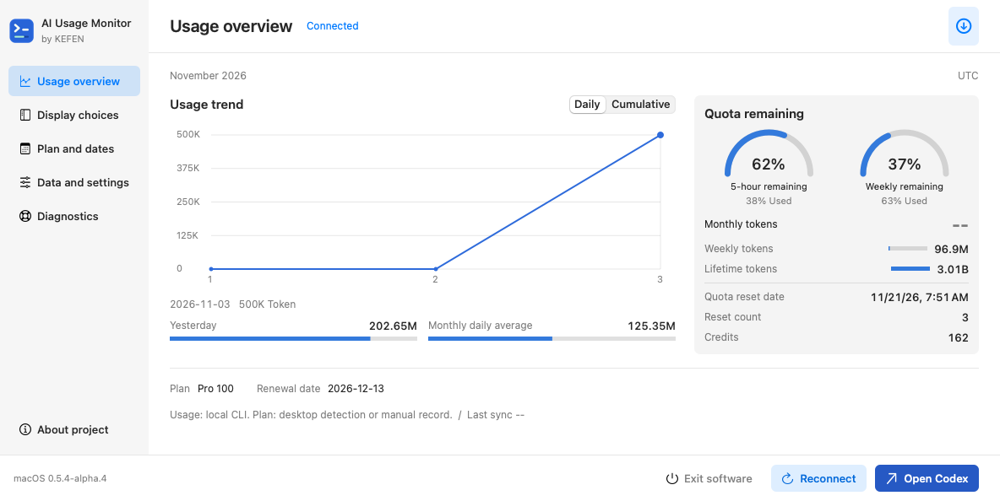
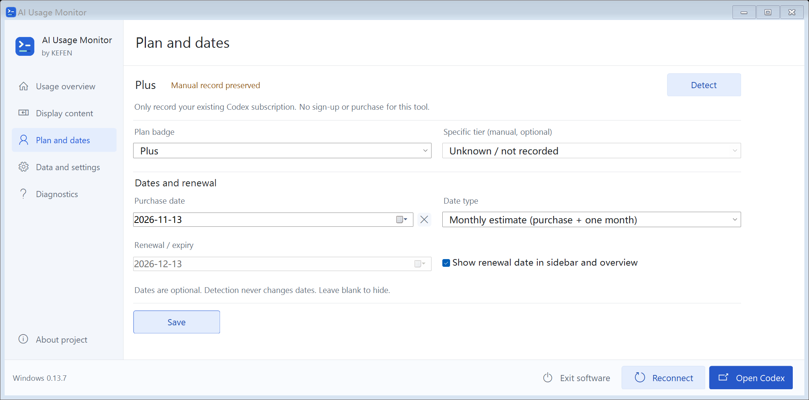
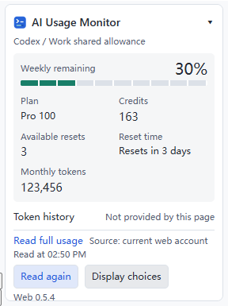

# AI Usage Monitor

by KEFEN · [简体中文](README.zh-CN.md)

See how much Codex quota you have left and how your token usage changes over time. On Windows and macOS, AI Usage Monitor puts quota readings in the Codex sidebar and usage history in a local dashboard. The standalone Chrome extension shows the usage figures ChatGPT makes available on the web. It doesn't need the desktop app.

This is an unofficial companion, not an OpenAI product. Token usage is not an API bill.

## Downloads

| Platform | Download | Installation |
| --- | --- | --- |
| Windows 10/11 (x64) | [Windows 0.13.8 installer](https://github.com/kefen/AI-Usage-Monitor/releases/download/windows%2Fv0.13.8/AI-Usage-Monitor-Windows-0.13.8-x64-Setup.exe) | Run Setup. When upgrading, choose your existing installation folder. The installer is unsigned. |
| macOS (Apple Silicon) | [Apple Silicon DMG, 0.5.4-alpha.5](https://github.com/kefen/AI-Usage-Monitor/releases/download/macos%2Fv0.5.4-alpha.5/AI-Usage-Monitor-macOS-0.5.4-alpha.5-arm64-unsigned-test.dmg) | For M-series Macs. Quit the old app and drag AI Usage Monitor into Applications. Not notarized. |
| macOS (Intel) | [Intel DMG, 0.5.4-alpha.5](https://github.com/kefen/AI-Usage-Monitor/releases/download/macos%2Fv0.5.4-alpha.5/AI-Usage-Monitor-macOS-0.5.4-alpha.5-x86_64-unsigned-test.dmg) | For Intel Macs. Same installation steps and notarization status. |
| Chrome | [Chrome 0.5.4 ZIP](https://github.com/kefen/AI-Usage-Monitor/releases/download/chrome%2Fv0.5.4/AI-Usage-Monitor-Chrome-0.5.4.zip) | Extract the ZIP and use **Load unpacked** in `chrome://extensions`. Not distributed through the Chrome Web Store. |

**Upgrading from an older desktop build?** Install Windows 0.13.8 or macOS 0.5.4-alpha.5 manually once. Older builds cannot discover this signing-key migration in the app. New builds check a separately signed update feed. Chrome is unaffected.

[User guide](docs/USER-GUIDE.md) · [Security and privacy](SECURITY.md) · [MIT license](LICENSE)

## Screenshots

English interfaces with sample data, not live account readings.

**macOS: Usage overview.** Compare daily or cumulative tokens with your remaining five-hour and weekly allowances.



**Windows: Plan and dates.** Record a plan and renewal date separately from the quota reset date.



**Chrome: ChatGPT sidebar.** Monthly tokens appear only when the page explicitly supplies the total.



## Before Downloading

### Updates

Click **Check for updates** in **About project**. Desktop builds check at startup
and every six hours while running; this is polling, not real-time push. Only a
verified newer version shows an update icon beside the language selector.
A new version offers background download,
then explicit confirmation to restart the companion and install. Codex itself stays
open. Settings are preserved. Updates use signed, expiring metadata with a pinned
Ed25519 public key plus package SHA-256 verification. Failed verification blocks
installation. Windows uses the existing transactional installer; Mac keeps a backup
app and verifies the new version's native launch acknowledgement. A safe rollback
is attempted if replacement or launch fails; if the new app is still running,
the backup is retained and Diagnostics explains the required action. Runtime crash
recovery after a successful launch is not automatic.

Unpacked Chrome extensions can check and link to a newer release but must be
downloaded, unpacked and reloaded in chrome://extensions; they cannot self-install.
Existing older installations must be upgraded once to gain update support.


**Windows:** this unsigned installer may show “Windows protected your PC” and
“Unknown publisher”. Verify the repository download and release SHA-256 first.
Only for that trusted file, choose **More info → Run anyway** if offered.
Do not disable Defender or SmartScreen. Managed computers may prohibit this.
Future code signing identifies the publisher but cannot guarantee immediate trust.

**Mac:** these experimental builds are not notarized. Read the bundled
**READ-ME-FIRST-macOS.html** before opening. Install into Applications first.
If blocked, choose **Done**, not Move to Trash. Go to
**System Settings → Privacy & Security → Open Anyway**, then confirm opening.
The app and bundled Node runtime may need separate approval. Approve only verified
downloads; do not disable Gatekeeper.


### Windows Compatibility

One x64 installer covers Windows 10/11; separate OS-specific packages are not
needed. Prefer a currently supported Windows release. Windows 11 ARM64 requires
a separately built and tested package before native support can be claimed;
none is currently shipped. Windows 7/8 and 32-bit x86 are not supported.

## Features

- Guided setup: environment checks, installation folder, sidebar choices,
  installation and explicit connection.
- Light gray and blue management UI, original terminal logo, regular typography,
  visible version and GitHub link.
- English, Simplified Chinese and Traditional Chinese. Desktop language also
  updates sidebar labels; browser language is independently selectable.
- Five-hour and weekly quota when returned, dated daily Token usage, weekly
  usage, daily average and account lifetime tokens.
- Configurable sidebar items and optional local Codex subscription records.
  This tool does **not** sell memberships, register accounts or change billing.
- Graceful old-panel shutdown, restart consent, diagnostic export and settings
  backup/restore.

## Windows Setup

1. Install and sign in to the official Microsoft Store Codex application.
2. Open Setup as your normal Windows user and follow the four steps.
3. Upgrades default to the detected installation. New installs default to
   `Documents/Codex/Apps/CodexSidebarMeter`. Choosing the same drive as Codex
   is an organizational suggestion, not a requirement. Never select the Codex
   application folder or WindowsApps. Preflight checks writing and free space.
4. If an older meter is running, use the guided stop action before continuing.
   Codex is not silently terminated.
5. Select sidebar items, install, then choose **Connect Codex**. Installation
   success is not connection success. Subscription dates can be skipped.
6. Review local-debugging consent. If Codex needs a restart, save work before
   confirming. Cancellation does not force a restart.

The runtime is bundled. Closing the window hides it to the tray; **Exit software**
stops this tool, not Codex. No persistent console is required. Settings backups
contain manual subscription dates, not credentials or connection consent.

The unsigned installer may show an unknown-publisher warning. Do not disable
security software. Installation does not modify Codex binaries, replace its
official shortcuts or silently register startup. Codex updates may require
companion compatibility changes.

To uninstall, exit the meter and run `Uninstall.cmd`. User settings and
externally modified files are retained.

## Data Semantics

- Quotas: `account/rateLimits/read`. Tokens: `account/usage/read`. Verify the
  local CLI account matches the desktop account. Neither is an API invoice.
- Daily selection prefers today, yesterday, then the latest valid dated record.
  Yesterday omits the numeric date; older fallback records remain dated. Missing data is not zero; returned zero is valid.
- Server bucket timezone is unverified. Today/yesterday labels use the device local calendar; month/week totals use UTC date-label comparison;
  calendar weeks start Monday and are independent of quota resets.
- Weekly totals use returned records only. Daily average uses current-month returned records divided by their available
  dates, excluding missing dates. Lifetime is the returned account total, not a quota extrapolation.
- Tokens refresh at startup and hourly; quotas approximately every minute.
  Stale values are not presented as fresh.
- Observation history retains up to 45 date/timestamp entries, not Token detail.
  Observation time is not publication time. Clear history after account changes.
- Plan families may be read from supported verified-desktop metadata; manual
  corrections are protected. Specific billing tiers and dates remain manual.
  Monthly/annual estimates are not
  verified bills and do not advance automatically after expiration.
- Subscription renewal and quota reset are separate concepts.

## Chrome Companion

**AI Usage Monitor 0.5.4.** Expand ChatGPT's left sidebar: the compact Mac-style quota ruler is at the bottom. Read the current account's weekly allowance, plan, credits, available resets and reset time where provided. Select **Read full usage** to bring back a confirmed snapshot. Monthly Tokens appear only if the official page explicitly provides the current month's total; the extension does not substitute local desktop data. On desktop, Monthly Tokens sum the returned daily records for the current UTC calendar month; incomplete coverage is marked as partial and is not treated as zero.

The extension observes changes already rendered by ChatGPT; it does not periodically refresh the site or hit a usage API. A daily public GitHub version check shows a toolbar badge and a link when a newer build exists. GitHub ZIPs must be replaced and reloaded manually.


## Security And Privacy

Read [SECURITY.md](SECURITY.md) first. CDP grants more access than quota reading.
Other local programs may access the debugging port. Stopping the meter does not
close it: fully quit Codex and reopen from the official entry.

The tool does not directly read passwords, authentication files, cookies,
conversation databases or chat content. No telemetry, remote upload service or
unattended update installation is added. Update checks contact GitHub; installation requires confirmation. The official CLI retains its own
authentication/network behavior. No independent security audit has been performed.

## Building

Windows requires Python 3.10+, PowerShell, the .NET Framework compiler and pinned
Node runtime. No third-party npm runtime dependencies are used. Runtime SHA256
and signer checks run during the build.

```powershell
powershell -NoProfile -ExecutionPolicy Bypass -File Build-Windows.ps1
node test/package-extract.mjs
powershell -NoProfile -ExecutionPolicy Bypass -File test/install.test.ps1
```

Outputs go to `dist/`. Explicit source/runtime manifests exclude personal
settings, logs and runtime state from source archives. Translations live in
`ui/strings.json`; run `node tools/sync-locales.mjs` after catalog changes.
Additional tests cover rollback, lifecycle, restart consent, native messaging and
UI layout. Playwright accepts `PLAYWRIGHT_MODULE` and `TEST_BROWSER_PATH`.
Fixture screenshots are not proof of live-account or Mac acceptance.

## macOS Boundary

The AppKit app shares the three-language catalog and six same-window sections.
Intel and Apple Silicon packages are built and UI-tested on their native GitHub
macOS runners. The user confirmed live connection on Apple Silicon; Intel
real-account acceptance remains pending. The packages are ad-hoc signed, not
Developer ID signed or notarized.


**Install once, launch normally:** quit the previous companion, open the correct
DMG, drag **AI Usage Monitor.app** to **Applications** (replace when upgrading),
then eject the DMG. Open **Finder > Applications > AI Usage Monitor** next time;
optionally choose **Options > Keep in Dock**. Double-clicking the app inside the
DMG does not install it. Read `READ-ME-FIRST.html` in the DMG before first launch.
The app's **About project > Show application in Finder** locates the installed copy.
Closing its window keeps monitoring in the menu bar; **Exit software** stops it.

`mac/trust.json` pins OpenAI's verified Team ID; the launcher also validates the
bundle identifier, full signature and loopback listener ownership. See the
[publisher audit](https://github.com/kefen/AI-Usage-Monitor/actions/runs/43805495761)
and [Mac installation instructions](docs/USER-GUIDE.md#macos-experimental-installation).
Do not bypass signature checks. Native compilation is not proof of live quota access.

## Contributing

Author: **KEFEN**. Update manifests, tests, versions and changelog together.
The accepted-release workflow publishes only the explicitly recorded release set
after its build and package checks pass. Normal CI does not publish releases.
See [third-party notices](THIRD_PARTY_NOTICES.md).
