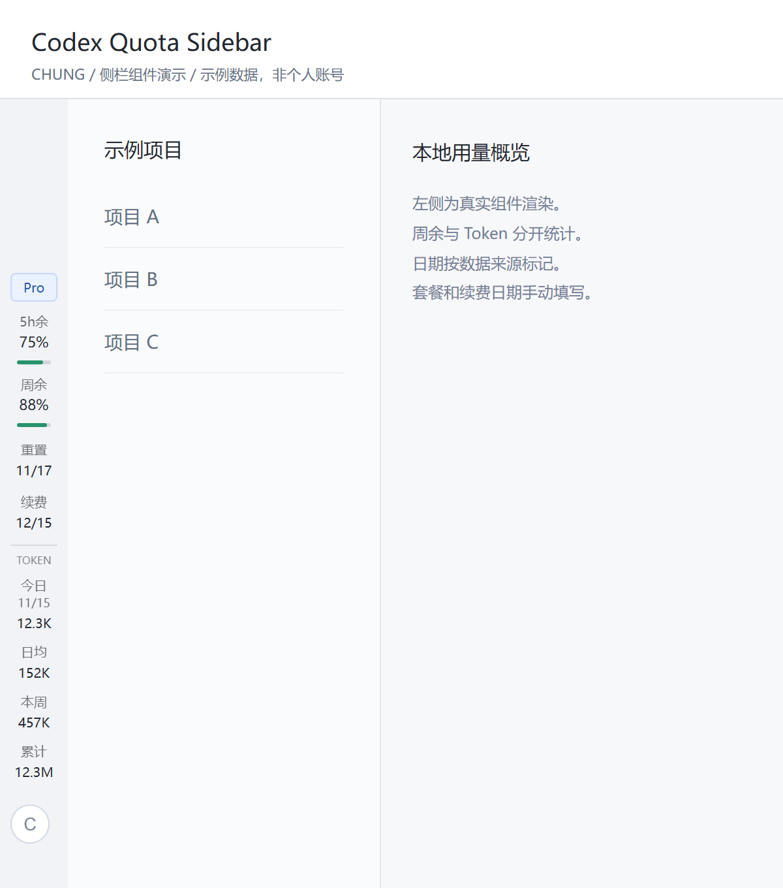
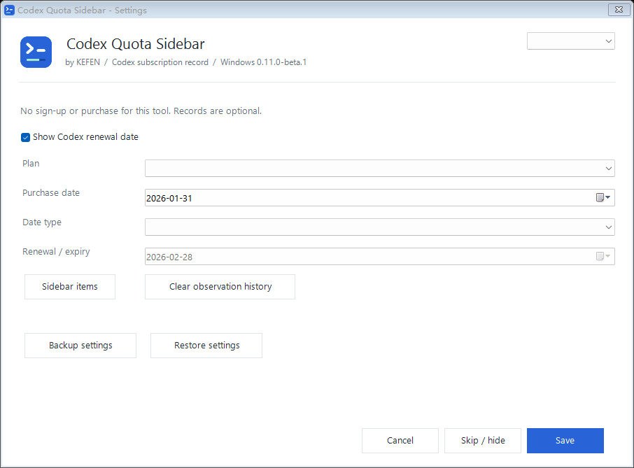
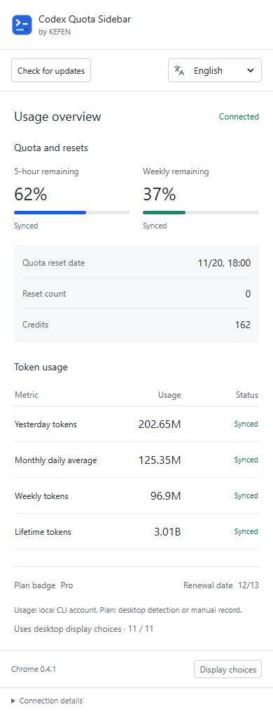

# Codex Quota Sidebar

Unofficial, local, read-only quota and token indicators in the Codex desktop
navigation rail. Not affiliated with or endorsed by OpenAI. MIT licensed.

Author: **CHUNG**. Original blue winking-terminal identity.

将额度与 Token 用量直接放在 Codex 桌面端的窄侧栏，无需每次打开用量页面。
提供可选择的显示项、可跳过的会员日期设置，以及读取本机快照的 Chrome 侧面板。

**实验项目，不是 OpenAI 官方插件。Windows 安装包未签名；Mac 仅提供实验源码。**

## 界面预览

以下截图由实际组件和原生窗口渲染，均使用示例数据，不包含作者的真实账号、对话或用量。
侧栏演示的周边布局是测试环境，并非完整 Codex 客户端截图。

### 侧栏用量



### Windows 安装与显示项选择


### 运行状态与操作


### 会员日期设置



### Chrome 侧面板



## 下载与使用

从本仓库的 **Releases** 选择对应平台的预发布版本：

- Windows：下载 `Windows-0.9.2-beta.1-x64-Setup.exe` 结尾的安装包。
- Chrome：下载 `Chrome-0.1.1.zip`，按照 [浏览器安装说明](browser/README.md) 配置本地辅助程序。
- macOS Apple Silicon：仅下载源码用于开发与验证，没有可直接安装的已验收版本。

Windows 设置中的“侧栏内容”控制显示项；会员日期需要单独填写并启用。
隐藏会员日期会保留已填信息。窗口 × 隐藏到托盘；“退出软件”停止本工具，不关闭 Codex。

## 状态

| 平台 | 独立版本 | 发布范围 |
| --- | --- | --- |
| Windows 10/11 x64 | 0.9.2-beta.1 | 本地候选安装包，公开发布待确认 |
| macOS Apple Silicon | 0.2.2-alpha.1 | 仅实验源码，实机验收前不分发安装包 |
| Chrome MV3 | 0.1.1 | 扩展候选包，依赖本机监控与辅助程序 |

桌面版本号集中在 `versions.json`；建议 Git 标签分别为 `windows/v0.9.2-beta.1`
和 `macos/v0.2.2-alpha.1`。共享 `src/`，Windows 启动器在根目录和 `native/`，
Mac 启动器在 `mac/`。架构不同的安装包不可混用。

## Windows 使用

1. 安装官方 Microsoft Store 版 Codex，并完成登录。无需另装 Node，安装包内置运行环境。
2. 双击 Windows Setup，默认安装到 `Documents/Codex/Apps/CodexSidebarMeter`。
   新安装的桌面入口叫 **Codex Quota Sidebar**；升级已有安装时保留原快捷方式。
3. 安装时勾选侧栏内容，之后可在设置修改。首次启动先确认本地调试接口的风险，再设置会员日期。可跳过，续费模块会隐藏。
4. 以后从面板入口启动；无需保留控制台。托盘提供设置、刷新、状态和停止。
5. Token 启动时读取，之后每小时刷新；额度约每分钟刷新。手动刷新至少间隔一分钟。
6. 卸载前先停止面板，再运行安装目录的 `Uninstall.cmd`。用户配置和修改过的文件保留。

安装器未签名，可能出现未知发布者提示；不要关闭安全软件。安装不需要管理员权限，
不会修改 Codex 安装文件、接管官方快捷方式或自动注册开机启动。新版 Codex 会重新定位，
但其界面或协议发生变化仍可能需要适配本工具。已有 Codex 未打开调试端口时，会先要求
用户确认重启；先保存工作。取消不会强制关闭 Codex。

## 数据口径

- 额度来自 `account/rateLimits/read`；Token 来自 `account/usage/read`。
  本机 CLI 账号可能与桌面账号不同，首次使用及换号后必须核对。
- 日用量自动选择当日、昨日、最近一次有效日期。始终显示月/日，悬停显示完整年月日。
  真实返回 0 就显示 0；未返回不当成 0。完全没有每日数据时隐藏日用量。
- 接口提供服务端日期标签，公开说明未明确其分桶时区。今日/昨日以 UTC 日期作相对比较，
  不是北京时间自然日统计；不将每日桶重新拼成无法证明的本地时区用量。
- 本周按日期标签、UTC 对照、周一起算；缺失日期不补零。日均是本周已返回记录总数除以
  有效日期数。累计直接使用返回的累计值，不由额度百分比推算，也不代表 API 账单。
- 每次正常查询记录该日期首次在本机被观察到的时间；日用量悬停可查看。
  这是观察时间而不是官方发布时间，精度受一小时查询间隔、休眠和断网影响。
  只保留最近 45 条日期及时间，不保存 Token 明细；设置中可清除。更换账号后请清除。
- 套餐可选 Free/Go/Plus/Pro/Business/Enterprise/Edu/其他，Pro 和 Business 可细分；侧栏仅显示大类。这是手动记录，不验证权益。
- 续费可填写购买日期并按日历月推算下个月对应日，Business 也可按年推算，月底取月末；
  也可手动指定真实续费或到期日。设置页预览计算结果。推算不是账单确认，过期不自动
  宣称续费成功。当前不自动识别账号切换，会员设置需自行核对。
- 额度重置与会员续费是两件事；状态过期时显示不可用，不伪造无限额度。

## 安全与隐私

浏览器版为 Chrome 原生侧面板，并非往 Codex 桌面侧栏安装浏览器插件。
它只读取本机监控生成的脱敏快照；不独立查询网页账号，也不跨设备同步。
安装和解除注册见 [browser/README.md](browser/README.md)。

请先阅读 [SECURITY.md](SECURITY.md)。CDP 的权限大于只读额度，本机其他进程可能访问
调试端口。停止面板不关闭端口；须完整退出 Codex 并从官方入口重开。本项目不直接读取
认证文件、密码、Cookie、会话数据库或聊天内容，不增加遥测/云同步/上传服务。
官方 CLI 自身仍会按既有认证和网络机制运行。本工具未经过独立安全审计。

## 从源码构建

Windows 要求 Node 24.16.0、Python 3.10+、系统 .NET Framework 4.x 编译器及 PowerShell。
程序无第三方 npm 运行时依赖。构建脚本只从官方固定 URL 取得 Node，并验证固定 SHA256。

```powershell
node --test test/*.test.mjs
powershell -NoProfile -ExecutionPolicy Bypass -File Build-Windows.ps1
node test/package-extract.mjs
```

构建输出位于 `dist/`。`build_release.py --source-only` 仅生成允许清单内的源码包；
不会把 `.runtime`、账号设置、日志、用户路径、构建缓存或 Node 二进制加入源码包。
源码清单为 `source-files.json`；Windows 运行文件清单为 `runtime-files.json`。
代码与文档变更应同步更新清单、版本号、测试和更新日志。

附加验证：`test/install.test.ps1`、`test/rollback.test.ps1`、`test/restart.test.ps1`、
`test/lifecycle.test.ps1`、`node test/native-host.mjs`。设置窗口测试见
`test/PreferencesTest.cs`。布局测试 `node test/ui.mjs` 需要外部 Playwright，
可用 `PLAYWRIGHT_MODULE` 指定模块、`TEST_BROWSER_PATH` 指定 Chromium。
`test/cdp-live.mjs` 使用隔离浏览器验证真实回环连接，不连接用户的 Codex。

## Mac 计划

Mac 目前没有可发布安装包。`mac/trust.json` 故意没有填开发者 Team ID，启动会拒绝，
直到实机核验官方签名身份后才能启用，不能仅凭应用名称判断身份。
还须完成首次设置界面、进程锁、升级保留配置、签名/公证评估及实际侧栏验收。
Windows 上的静态检查和共享逻辑测试不能替代这些验收，见 [RELEASE-CHECKLIST.md](RELEASE-CHECKLIST.md)。

## 开源发布

仓库名为 `codex-quota-sidebar`，作者 CHUNG，采用 MIT 许可。
CI 配置仅测试/构建，没有自动发布或自动更新执行逻辑。
请从正式仓库的对应标签核验源码和校验值，第三方许可见 [THIRD_PARTY_NOTICES.md](THIRD_PARTY_NOTICES.md)。

