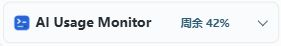

# AI Usage Monitor
by KEFEN · [简体中文](README.zh-CN.md)

## Current: desktop and web

Open the workbench to see Codex and Claude Code usage over time, or dock the compact desktop panel on any screen edge. Hover to expand it, pin it in place, or keep it on top. Both views share the glass appearance setting. Claude Code readings come from its status line; missing quota is not zero.

[Windows 0.16.14 (x64)](https://github.com/kefen/AI-Usage-Monitor/releases/tag/windows%2Fv0.16.14) · [macOS 0.16.15 (r2 DMGs for Apple Silicon and Intel)](https://github.com/kefen/AI-Usage-Monitor/releases/tag/macos%2Fv0.16.15) · [Chrome 0.6.0](https://github.com/kefen/AI-Usage-Monitor/releases/tag/chrome%2Fv0.6.0)

Chrome runs independently and shows only what the current ChatGPT web account provides. Collapse the panel to keep weekly remaining in view. To upgrade the unpacked extension, replace files in its original folder, reload the extension, then refresh ChatGPT.

## Earlier: in-tool display

The old **in-Codex sidebar** was inside the host window, unlike the current desktop panel. Published versions in that line include Windows **0.13.6, 0.13.7, 0.13.8, 0.14.0 and 0.14.1**, and macOS **0.5.4-alpha.4, 0.5.4-alpha.5 and 0.6.0-alpha.1**. Compatibility with current host versions is not guaranteed.

**Claude Code: local desktop build 0.15.2** includes terminal status-line output, not an embedded sidebar in the Claude desktop app. No corresponding public 0.15.2 release was found; the Codex tags above do not establish Claude support.

[Archived guide and screenshots](README.legacy.md) · [Past releases](https://github.com/kefen/AI-Usage-Monitor/releases) · [Security](SECURITY.md)

Unofficial companion. Token usage is not an API bill.
