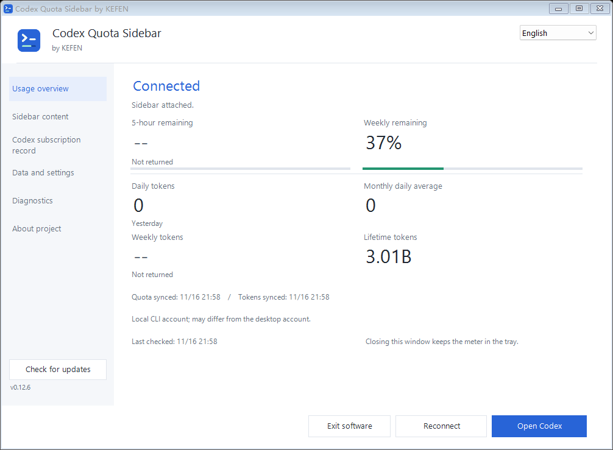
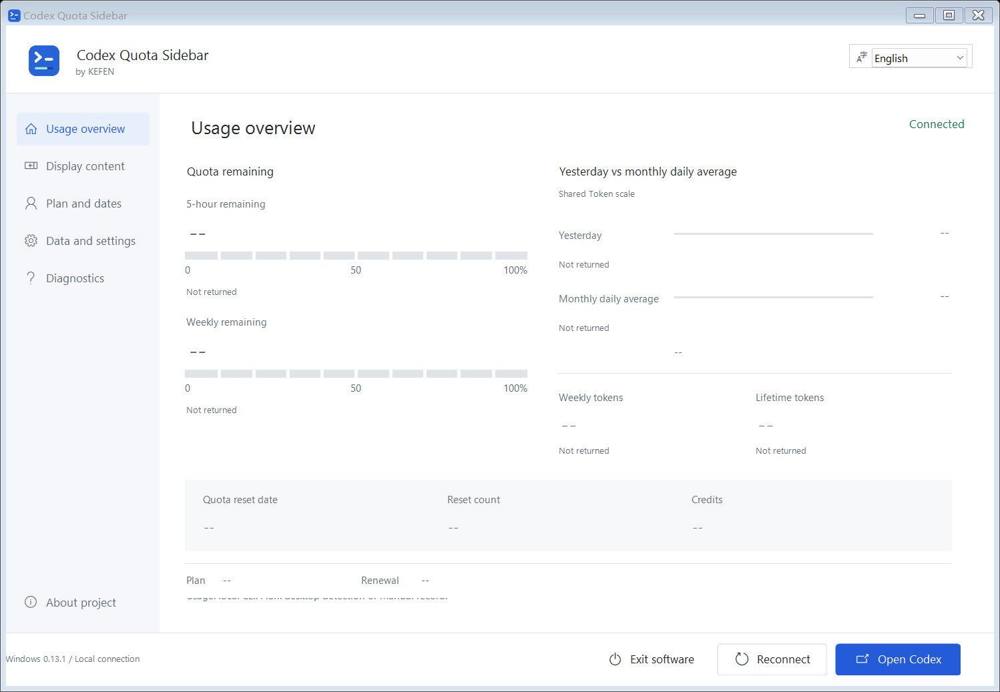
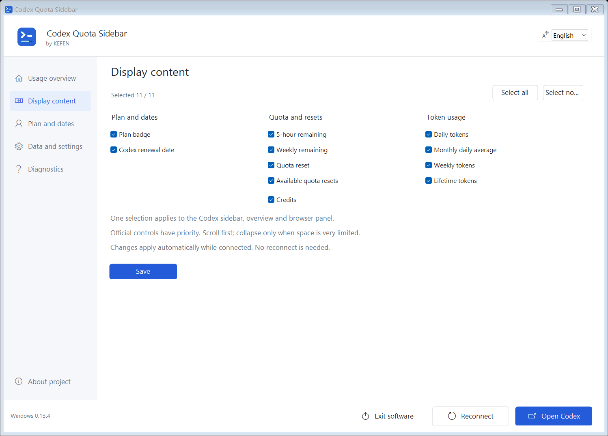
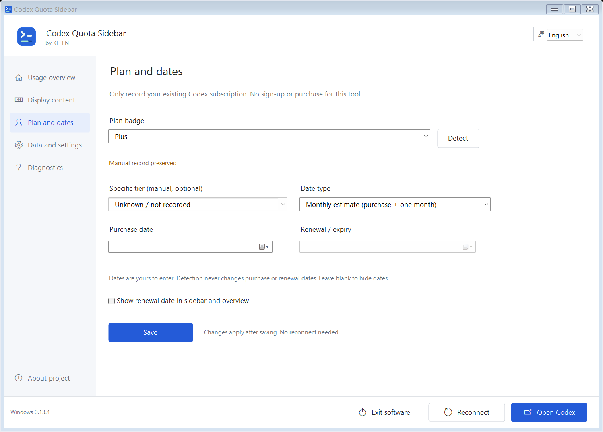
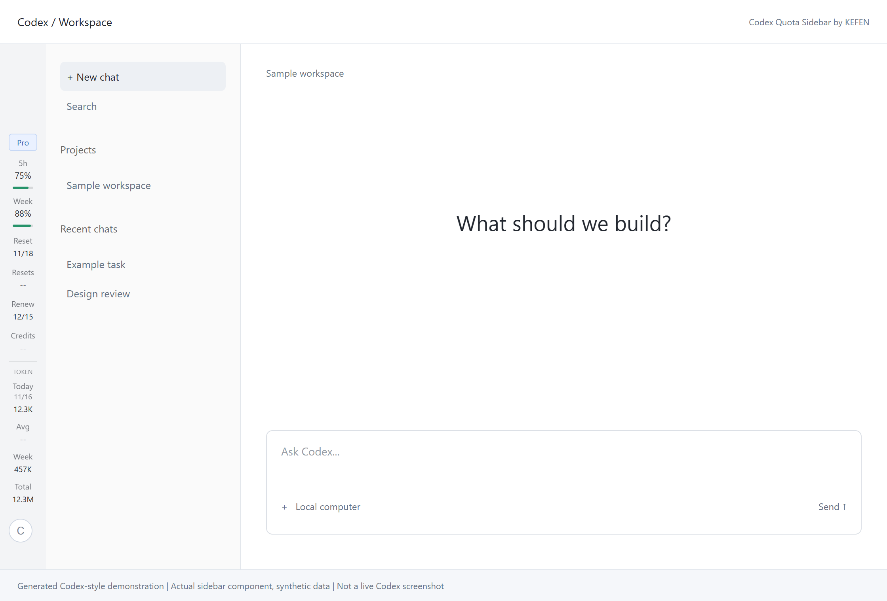
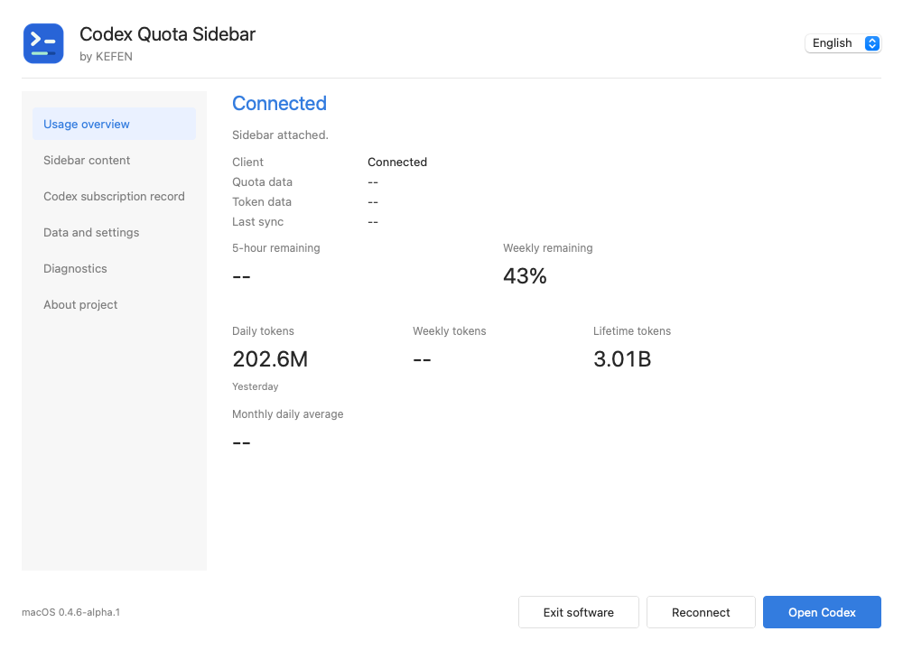
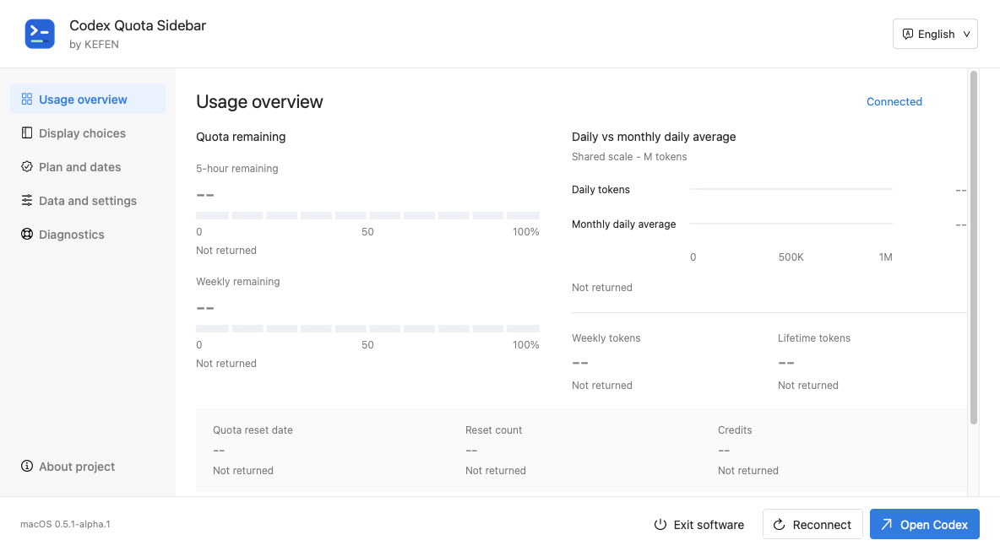

# Codex Quota Sidebar by KEFEN

An unofficial local companion that puts quota and Token usage in the Codex
desktop navigation rail. Not affiliated with or endorsed by OpenAI.

**Author: KEFEN.**

[GitHub](https://github.com/kefen/codex-quota-sidebar) | [Security](SECURITY.md) | [MIT license](LICENSE)

## Before Downloading

### Updates

Click **Check for updates** in **About project**. Desktop builds check at startup
and every six hours while running; this is polling, not real-time push. Only a
verified newer version shows an update icon beside the language selector.
A new version offers background download,
then explicit confirmation to restart the companion and install. Codex itself stays
open. Settings are preserved. Updates use signed, expiring metadata with a pinned
Ed25519 public key plus package SHA-256 verification. Failed verification blocks
installation. Windows uses the existing transactional installer; Mac keeps a backup
app and verifies the new version's native launch acknowledgement. A safe rollback
is attempted if replacement or launch fails; if the new app is still running,
the backup is retained and Diagnostics explains the required action. Runtime crash
recovery after a successful launch is not automatic.

Unpacked Chrome extensions can check and link to a newer release but must be
downloaded, unpacked and reloaded in chrome://extensions; they cannot self-install.
Existing older installations must be upgraded once to gain update support.

在“关于项目”点击“检查更新”；仅发现已验证的新版时，语言选择旁显示更新图标。启动时及运行中每六小时检查，并非实时推送。已是最新版与网络失败会分别提示。桌面端可后台下载，确认后重启本工具安装，保留设置、不关闭 Codex。浏览器手动加载版需下载解压后重新加载。旧版 Mac 更新器失败时，请按安装指南手动替换一次应用。

**Windows:** this unsigned installer may show “Windows protected your PC” and
“Unknown publisher”. Verify the repository download and release SHA-256 first.
Only for that trusted file, choose **More info → Run anyway** if offered.
Do not disable Defender or SmartScreen. Managed computers may prohibit this.
Future code signing identifies the publisher but cannot guarantee immediate trust.

**Mac:** these experimental builds are not notarized. Read the bundled
**READ-ME-FIRST-macOS.html** before opening. Install into Applications first.
If blocked, choose **Done**, not Move to Trash. Go to
**System Settings → Privacy & Security → Open Anyway**, then confirm opening.
The app and bundled Node runtime may need separate approval. Approve only verified
downloads; do not disable Gatekeeper.

Windows：核对来源及校验值后，如系统允许，可选择“更多信息 → 仍要运行”，不要关闭防护。
Mac：被拦截时选择“完成”，不要移到废纸篓；到“系统设置 → 隐私与安全性 → 仍要打开”，再次确认。应用和 Node 可能需分别授权。

### Windows Compatibility

One x64 installer covers Windows 10/11; separate OS-specific packages are not
needed. Prefer a currently supported Windows release. Windows 11 ARM64 requires
a separately built and tested package before native support can be claimed;
none is currently shipped. Windows 7/8 and 32-bit x86 are not supported.

## Screenshots

**Current versions:** Windows **0.13.1**, macOS **0.5.1-alpha.1**
(Apple Silicon and Intel), Chrome **0.4.1**.

The V3 desktop overview uses quota rulers and a shared-scale comparison of daily
tokens with the monthly daily average, followed by weekly and lifetime totals.
All eleven sidebar display choices are shared with the overview; unchecked items
are hidden and empty groups collapse. Selected items with missing data retain
their position. The browser uses quota bars and a roomier Token table.
Zero is a real value; missing
data says **Not returned**, expired data says **Data expired**, and disconnected
desktop views say **Not connected**. Weekly calculations are unchanged.
Plan-family detection reads supported metadata from the verified desktop renderer,
never the CLI account. If needed, it briefly opens the official usage menu to read
an exact quota-source label and restores the menu it opened. It never reads chat
content or guesses from a profile name. Unsupported or ambiguous labels remain
**Unknown**, with manual selection available. Manual corrections are locked until you explicitly choose **Detect
plan** again. Detection never guesses or replaces your specific billing tier,
purchase date or renewal date. No billing credentials are scraped.

Current Windows and Chrome interfaces, rendered with **synthetic sample data**,
not a real account. The sidebar screenshot uses a test shell rather than the
full Codex application. Native window chrome depends on Windows settings.

### Guided installation


### Usage overview


### Partial and missing data



### Shared display choices and protected subscription records



### Inline sidebar


Generated Codex-style demonstration using the actual sidebar component and
synthetic data. Not a capture of the live Codex application or a real account.

### Chrome companion


### macOS experimental companion




Actual AppKit view captured on a macOS Actions runner with synthetic settings;
not evidence of live-account connection acceptance.

## Status

| Platform | Version | Availability |
| --- | --- | --- |
| Windows 10/11 x64 | 0.13.1 | V3 interface; unsigned installer |
| macOS Apple Silicon / Intel | 0.5.1-alpha.1 | V3 experimental DMGs; not notarized; prior Apple Silicon connection user-confirmed, Intel account testing pending |
| Chrome MV3 | 0.4.1 | V3 companion extension; requires the local desktop monitor and native host |

The Windows 0.12.3 interface was accepted by the user on 2026-11-16; 0.12.6 adds
the requested statistics and read-only balance/reset indicators. A prior
installer-only fix handles legacy Unicode shortcut cleanup on English Windows.
Platform versions are
independent; Windows acceptance does not imply macOS or browser-profile acceptance.
Mac packages require macOS 13.5+ and a compatible official Codex client. The
currently audited official download is Apple Silicon only; the Intel companion
does not make an ARM-only official client compatible with Intel.

## Downloads And Instructions

- [Windows installer and checksums](https://github.com/kefen/codex-quota-sidebar/releases/tag/windows/v0.13.1)
- [Chrome extension ZIP](https://github.com/kefen/codex-quota-sidebar/releases/tag/chrome/v0.4.1)
- [macOS experimental installers, both architectures](https://github.com/kefen/codex-quota-sidebar/releases/tag/macos/v0.5.1-alpha.1)
- **[Step-by-step illustrated user guide](docs/USER-GUIDE.md)**
- [Release and acceptance record](docs/RELEASES.md)

Use the named setup/extension assets, not GitHub's automatically generated source
ZIP, to install Windows or Chrome. Only Windows is promoted to stable; Mac and
browser remain explicitly experimental. Mac's limited user confirmation does not
establish compatibility with every client version or Intel device.

**Browser upgrade:** the native-host name is now `org.kefen.codex_quota_sidebar`.
Update both desktop and extension, and register again. Follow the
[browser migration steps](browser/README.md#upgrading-from-earlier-versions).

## Features

- Guided setup: environment checks, installation folder, sidebar choices,
  installation and explicit connection.
- Light gray and blue management UI, original terminal logo, regular typography,
  visible version and GitHub link.
- English, Simplified Chinese and Traditional Chinese. Desktop language also
  updates sidebar labels; browser language is independently selectable.
- Five-hour and weekly quota when returned, dated daily Token usage, weekly
  usage, daily average and account lifetime tokens.
- Configurable sidebar items and optional local Codex subscription records.
  This tool does **not** sell memberships, register accounts or change billing.
- Graceful old-panel shutdown, restart consent, diagnostic export and settings
  backup/restore.

## Windows Setup

1. Install and sign in to the official Microsoft Store Codex application.
2. Open Setup as your normal Windows user and follow the four steps.
3. Upgrades default to the detected installation. New installs default to
   `Documents/Codex/Apps/CodexSidebarMeter`. Choosing the same drive as Codex
   is an organizational suggestion, not a requirement. Never select the Codex
   application folder or WindowsApps. Preflight checks writing and free space.
4. If an older meter is running, use the guided stop action before continuing.
   Codex is not silently terminated.
5. Select sidebar items, install, then choose **Connect Codex**. Installation
   success is not connection success. Subscription dates can be skipped.
6. Review local-debugging consent. If Codex needs a restart, save work before
   confirming. Cancellation does not force a restart.

The runtime is bundled. Closing the window hides it to the tray; **Exit software**
stops this tool, not Codex. No persistent console is required. Settings backups
contain manual subscription dates, not credentials or connection consent.

The unsigned installer may show an unknown-publisher warning. Do not disable
security software. Installation does not modify Codex binaries, replace its
official shortcuts or silently register startup. Codex updates may require
companion compatibility changes.

To uninstall, exit the meter and run `Uninstall.cmd`. User settings and
externally modified files are retained.

## Data Semantics

- Quotas: `account/rateLimits/read`. Tokens: `account/usage/read`. Verify the
  local CLI account matches the desktop account. Neither is an API invoice.
- Daily selection prefers today, yesterday, then the latest valid dated record.
  Yesterday omits the numeric date; older fallback records remain dated. Missing data is not zero; returned zero is valid.
- Server bucket timezone is unverified. Today/yesterday labels use the device local calendar; month/week totals use UTC date-label comparison;
  calendar weeks start Monday and are independent of quota resets.
- Weekly totals use returned records only. Daily average uses current-month returned records divided by their available
  dates, excluding missing dates. Lifetime is the returned account total, not a quota extrapolation.
- Tokens refresh at startup and hourly; quotas approximately every minute.
  Stale values are not presented as fresh.
- Observation history retains up to 45 date/timestamp entries, not Token detail.
  Observation time is not publication time. Clear history after account changes.
- Plan families may be read from supported verified-desktop metadata; manual
  corrections are protected. Specific billing tiers and dates remain manual.
  Monthly/annual estimates are not
  verified bills and do not advance automatically after expiration.
- Subscription renewal and quota reset are separate concepts.

## Chrome Companion

See [browser setup](browser/README.md) for native-host registration. This uses
Chrome's side panel, not a browser extension inside Codex desktop. It reads
sanitized local snapshots, not website cookies, and has no cross-device sync.
The desktop monitor must be running.

## Security And Privacy

Read [SECURITY.md](SECURITY.md) first. CDP grants more access than quota reading.
Other local programs may access the debugging port. Stopping the meter does not
close it: fully quit Codex and reopen from the official entry.

The tool does not directly read passwords, authentication files, cookies,
conversation databases or chat content. No telemetry, remote upload service or
unattended update installation is added. Update checks contact GitHub; installation requires confirmation. The official CLI retains its own
authentication/network behavior. No independent security audit has been performed.

## Building

Windows requires Python 3.10+, PowerShell, the .NET Framework compiler and pinned
Node runtime. No third-party npm runtime dependencies are used. Runtime SHA256
and signer checks run during the build.

```powershell
powershell -NoProfile -ExecutionPolicy Bypass -File Build-Windows.ps1
node test/package-extract.mjs
powershell -NoProfile -ExecutionPolicy Bypass -File test/install.test.ps1
```

Outputs go to `dist/`. Explicit source/runtime manifests exclude personal
settings, logs and runtime state from source archives. Translations live in
`ui/strings.json`; run `node tools/sync-locales.mjs` after catalog changes.
Additional tests cover rollback, lifecycle, restart consent, native messaging and
UI layout. Playwright accepts `PLAYWRIGHT_MODULE` and `TEST_BROWSER_PATH`.
Fixture screenshots are not proof of live-account or Mac acceptance.

## macOS Boundary

The AppKit app shares the three-language catalog and six same-window sections.
Intel and Apple Silicon packages are built and UI-tested on their native GitHub
macOS runners. The user confirmed live connection on Apple Silicon; Intel
real-account acceptance remains pending. The packages are ad-hoc signed, not
Developer ID signed or notarized.

**Install once, launch normally:** quit the previous companion, open the correct
DMG, drag **Codex Quota Sidebar.app** to **Applications** (replace when upgrading),
then eject the DMG. Open **Finder > Applications > Codex Quota Sidebar** next time;
optionally choose **Options > Keep in Dock**. Double-clicking the app inside the
DMG does not install it. Read `READ-ME-FIRST.html` in the DMG before first launch.
The app's **About project > Show application in Finder** locates the installed copy.
Closing its window keeps monitoring in the menu bar; **Exit software** stops it.

`mac/trust.json` pins OpenAI's verified Team ID; the launcher also validates the
bundle identifier, full signature and loopback listener ownership. See the
[publisher audit](https://github.com/kefen/codex-quota-sidebar/actions/runs/43805495761)
and [Mac installation instructions](docs/USER-GUIDE.md#macos-experimental-installation).
Do not bypass signature checks. Native compilation is not proof of live quota access.

## Contributing

Author: **KEFEN**. Update manifests, tests, versions and changelog together.
The accepted-release workflow publishes only the explicitly recorded release set
after its build and package checks pass. Normal CI does not publish releases.
See [third-party notices](THIRD_PARTY_NOTICES.md).
