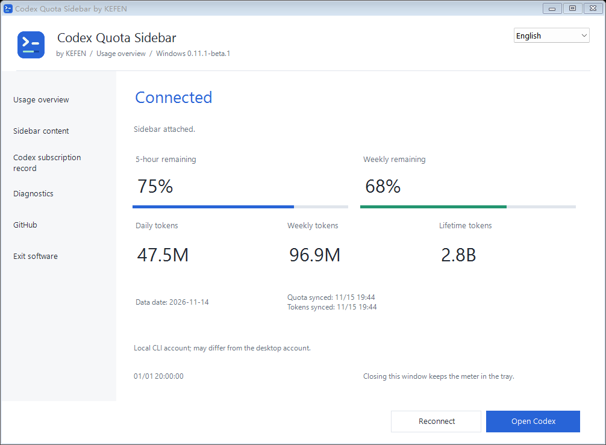

# Codex Quota Sidebar by KEFEN

An unofficial local companion that puts quota and Token usage in the Codex
desktop navigation rail. Not affiliated with or endorsed by OpenAI.

**Author: KEFEN.**

[GitHub](https://github.com/kefen/codex-quota-sidebar) | [Security](SECURITY.md) | [MIT license](LICENSE)

## Screenshots

Current Windows and Chrome interfaces, rendered with **synthetic sample data**,
not a real account. The sidebar screenshot uses a test shell rather than the
full Codex application. Native window chrome depends on Windows settings.

### Guided installation


### Usage overview


### Inline sidebar


Generated Codex-style demonstration using the actual sidebar component and
synthetic data. Not a capture of the live Codex application or a real account.

### Chrome companion


## Status

| Platform | Version | Availability |
| --- | --- | --- |
| Windows 10/11 x64 | 0.11.1-beta.1 | Branding patch on accepted 0.11.0; unsigned installer |
| macOS Apple Silicon | 0.3.1-alpha.1 | Experimental source; not compiled or tested on Mac |
| Chrome MV3 | 0.2.1 | Experimental companion; requires the Windows native host |

Windows 0.11.0 user acceptance was confirmed on 2026-11-15. This branding patch
has automated verification but no separate user acceptance. Platform versions are
independent; Windows acceptance does not imply macOS or browser-profile acceptance.

## Downloads And Instructions

- [Windows installer and checksums](https://github.com/kefen/codex-quota-sidebar/releases/tag/windows/v0.11.1-beta.1)
- [Chrome extension ZIP](https://github.com/kefen/codex-quota-sidebar/releases/tag/chrome/v0.2.1)
- [macOS experimental source only](https://github.com/kefen/codex-quota-sidebar/releases/tag/macos/v0.3.1-alpha.1)
- **[Step-by-step illustrated user guide](docs/USER-GUIDE.md)**
- [Release and acceptance record](docs/RELEASES.md)

Use the named setup/extension assets, not GitHub's automatically generated source
ZIP, to install Windows or Chrome. All three releases are prereleases.

**Browser upgrade:** the native-host name is now `org.kefen.codex_quota_sidebar`.
Update both desktop and extension, and register again. Follow the
[browser migration steps](browser/README.md#upgrading-from-earlier-versions).

## Features

- Guided setup: environment checks, installation folder, sidebar choices,
  installation and explicit connection.
- Light gray and blue management UI, original terminal logo, regular typography,
  visible version and GitHub link.
- English, Simplified Chinese and Traditional Chinese. Desktop language also
  updates sidebar labels; browser language is independently selectable.
- Five-hour and weekly quota when returned, dated daily Token usage, weekly
  usage, daily average and account lifetime tokens.
- Configurable sidebar items and optional local Codex subscription records.
  This tool does **not** sell memberships, register accounts or change billing.
- Graceful old-panel shutdown, restart consent, diagnostic export and settings
  backup/restore.

## Windows Setup

1. Install and sign in to the official Microsoft Store Codex application.
2. Open Setup as your normal Windows user and follow the four steps.
3. Upgrades default to the detected installation. New installs default to
   `Documents/Codex/Apps/CodexSidebarMeter`. Choosing the same drive as Codex
   is an organizational suggestion, not a requirement. Never select the Codex
   application folder or WindowsApps. Preflight checks writing and free space.
4. If an older meter is running, use the guided stop action before continuing.
   Codex is not silently terminated.
5. Select sidebar items, install, then choose **Connect Codex**. Installation
   success is not connection success. Subscription dates can be skipped.
6. Review local-debugging consent. If Codex needs a restart, save work before
   confirming. Cancellation does not force a restart.

The runtime is bundled. Closing the window hides it to the tray; **Exit software**
stops this tool, not Codex. No persistent console is required. Settings backups
contain manual subscription dates, not credentials or connection consent.

The unsigned installer may show an unknown-publisher warning. Do not disable
security software. Installation does not modify Codex binaries, replace its
official shortcuts or silently register startup. Codex updates may require
companion compatibility changes.

To uninstall, exit the meter and run `Uninstall.cmd`. User settings and
externally modified files are retained.

## Data Semantics

- Quotas: `account/rateLimits/read`. Tokens: `account/usage/read`. Verify the
  local CLI account matches the desktop account. Neither is an API invoice.
- Daily selection prefers today, yesterday, then the latest valid dated record.
  Dates stay visible. Missing data is not zero; returned zero is valid.
- Server bucket timezone is unverified. Relative dates use UTC comparison;
  calendar weeks start Monday and are independent of quota resets.
- Weekly totals use returned records only. Daily average divides by available
  dates. Lifetime is the returned account total, not a quota extrapolation.
- Tokens refresh at startup and hourly; quotas approximately every minute.
  Stale values are not presented as fresh.
- Observation history retains up to 45 date/timestamp entries, not Token detail.
  Observation time is not publication time. Clear history after account changes.
- Plans and renewal dates are manual records. Monthly/annual estimates are not
  verified bills and do not advance automatically after expiration.
- Subscription renewal and quota reset are separate concepts.

## Chrome Companion

See [browser setup](browser/README.md) for native-host registration. This uses
Chrome's side panel, not a browser extension inside Codex desktop. It reads
sanitized local snapshots, not website cookies, and has no cross-device sync.
The desktop monitor must be running.

## Security And Privacy

Read [SECURITY.md](SECURITY.md) first. CDP grants more access than quota reading.
Other local programs may access the debugging port. Stopping the meter does not
close it: fully quit Codex and reopen from the official entry.

The tool does not directly read passwords, authentication files, cookies,
conversation databases or chat content. No telemetry, remote upload service or
automatic update installation is added. The official CLI retains its own
authentication/network behavior. No independent security audit has been performed.

## Building

Windows requires Python 3.10+, PowerShell, the .NET Framework compiler and pinned
Node runtime. No third-party npm runtime dependencies are used. Runtime SHA256
and signer checks run during the build.

```powershell
powershell -NoProfile -ExecutionPolicy Bypass -File Build-Windows.ps1
node test/package-extract.mjs
powershell -NoProfile -ExecutionPolicy Bypass -File test/install.test.ps1
```

Outputs go to `dist/`. Explicit source/runtime manifests exclude personal
settings, logs and runtime state from source archives. Translations live in
`ui/strings.json`; run `node tools/sync-locales.mjs` after catalog changes.
Additional tests cover rollback, lifecycle, restart consent, native messaging and
UI layout. Playwright accepts `PLAYWRIGHT_MODULE` and `TEST_BROWSER_PATH`.
Fixture screenshots are not proof of live-account or Mac acceptance.

## macOS Boundary

The AppKit management source follows the same design and three-language catalog,
including usage overview and GitHub navigation. There is **no accepted Mac
installer or binary**. Windows cannot verify AppKit compilation or layout.

`mac/trust.json` intentionally lacks a developer Team ID and fails closed
until the official app signature is verified on a real Mac. Do not remove this
check to make a build launch. Packaging, upgrade preservation, signing,
notarization and live sidebar acceptance remain release gates.
See [release checklist](RELEASE-CHECKLIST.md).

## Contributing

Author: **KEFEN**. Update manifests, tests, versions and changelog together.
The accepted-release workflow publishes only the explicitly recorded release set
after its build and package checks pass. Normal CI does not publish releases.
See [third-party notices](THIRD_PARTY_NOTICES.md).
