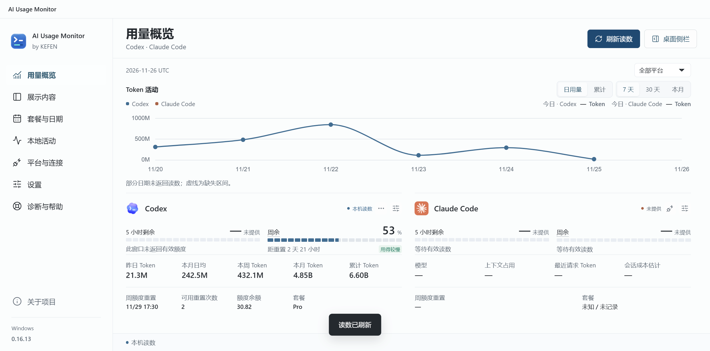
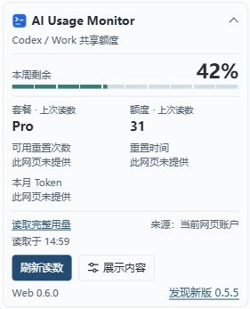
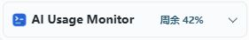

# AI Usage Monitor
by KEFEN · [English](README.md)

## 当前版本：工作台、桌面侧栏与网页插件

想看趋势，打开工作台；只想随时看周余，把桌面侧栏拖到屏幕任意一边。移开鼠标后侧栏收起，悬停再展开。也可以固定位置、保持置顶。两个界面共用玻璃透明度。

| 平台 | 下载 | 安装 |
| --- | --- | --- |
| Windows x64 | [0.16.16 安装程序](https://github.com/kefen/AI-Usage-Monitor/releases/tag/windows%2Fv0.16.16) | 运行 Setup.exe |
| macOS | [0.16.16，r2 DMG](https://github.com/kefen/AI-Usage-Monitor/releases/tag/macos%2Fv0.16.16) | M 系列选 Apple Silicon，Intel 选 Intel |
| Chrome | [0.6.0 ZIP](https://github.com/kefen/AI-Usage-Monitor/releases/tag/chrome%2Fv0.6.0) | 解压后加载；升级请覆盖原目录并重新加载 |

桌面端分开显示 Codex 和 Claude Code 的数据。Claude Code 通过状态行回调接入；配置存在不等于已经收到回调，未返回的额度不当作零。Chrome 插件独立运行，只读取当前 ChatGPT 网页给出的用量，折叠时仍显示周余。

Chrome 0.6.0：同一面板展开与收起。截图是拍摄时的读数，并非实时数据。

## 往期版本：工具内显示

旧版的窄栏在 **Codex 窗口内部**，不是当前的桌面贴边栏。公开记录中的 Codex 内嵌系列包括 Windows **0.13.6、0.13.7、0.13.8、0.14.0、0.14.1**，macOS **0.5.4-alpha.4、0.5.4-alpha.5、0.6.0-alpha.1**。历史兼容性不代表能适配今天的 Codex。

**Claude Code：本地桌面版 0.15.2** 的安装包中包含终端状态行输出。它在 Claude Code 终端内显示，不是 Claude 桌面窗口里的独立侧栏。未找到 0.15.2 对应的公开 Release；上面列举的 Codex 标签不代表同期也支持 Claude。

[旧版完整说明与截图](README.legacy.zh-CN.md) · [历史下载](https://github.com/kefen/AI-Usage-Monitor/releases) · [安全与隐私](SECURITY.md)

非官方工具。Token 统计不等同于 API 账单。
