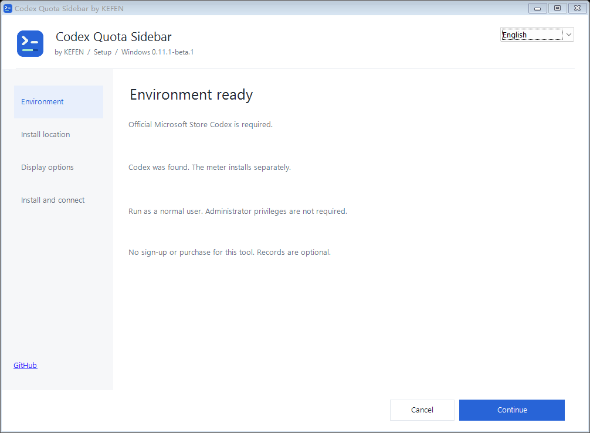
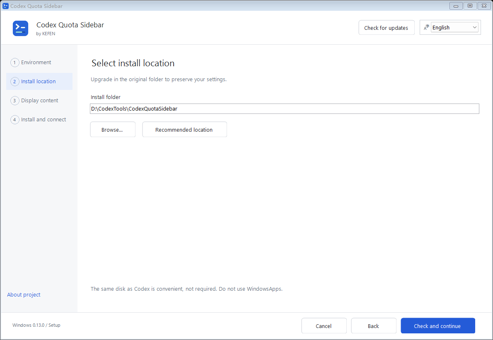
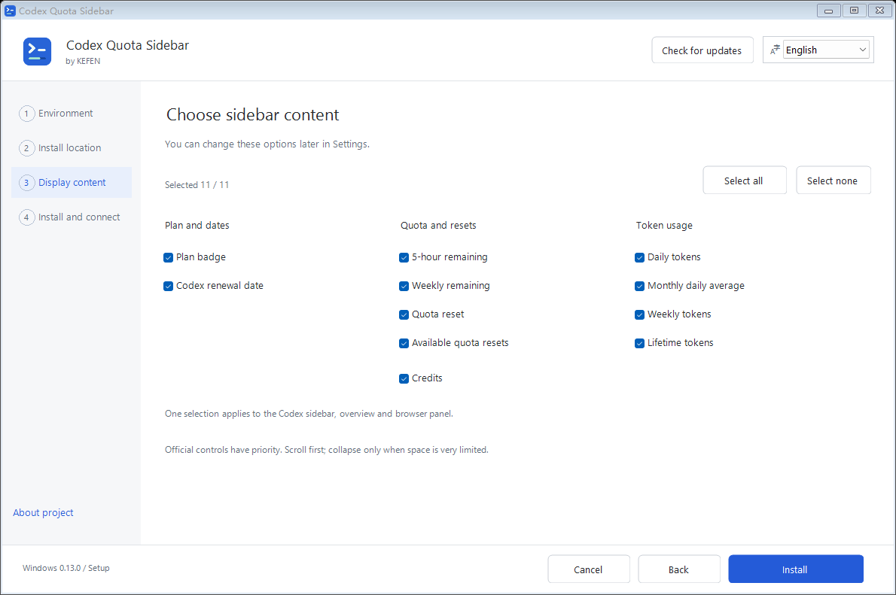
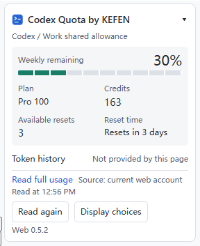

# User Guide

## Reading the Overview

Desktop V3 uses quota rulers and a shared-scale daily/monthly-average Token
comparison, then weekly and lifetime totals. Chrome uses the web account instead (see section 8). The eleven desktop display selections are shared with the sidebar;
unchecked fields disappear and empty groups collapse. Selected missing fields
remain visible. **0** means a returned
zero, **Not returned** means the source supplied no usable value, **Data expired**
means it is too old, and **Not connected** describes a disconnected desktop view.
An absent five-hour quota is not treated as unlimited. Yesterday has no numeric
date below it; older daily records keep their source date.

On a fresh installation, the companion attempts plan-family detection after
connecting to a verified Codex desktop renderer. Supported structured metadata
is preferred. If needed, the tool briefly opens the official usage menu, reads
only an exact quota-source label and restores the menu it opened. It never reads
chat content or infers a plan from profile names. Some clients expose no supported label, so **Unknown** is a normal
outcome, not a paid-tier guess. Choose the plan manually if detection is unavailable.
Changing the plan manually locks it against automatic replacement. **Detect plan**
is an explicit retry and replaces the family only: manual tier and all dates stay
unchanged. Legacy manual subscription records are protected too.

简体中文：展示内容与侧栏同步，共 11 项。未返回、过期、未连接会明确标注，真实零值保留。套餐只从可核验的桌面字段尝试识别，失败可手动选择；手动修改后锁定，除非主动再次识别。识别不会修改档位或日期。
繁體中文：顯示內容與側欄同步，共 11 項。未回傳、過期、未連線均明確標示，真實零值保留。方案僅從可驗證的桌面欄位嘗試辨識，失敗可手動選擇；手動修改後鎖定，除非主動再次辨識。辨識不會修改級別或日期。

## Updating

Use **Check for updates** in **About project**. A verified newer version alone
shows an update icon beside the language selector. The companion checks at startup
and every six hours while running; this is not real-time server push. Up-to-date,
network failure and verification failure are distinct results.
Desktop updates show the version and short numbered notes in your selected
language, then ask to download in the background. When ready,
confirm restarting this companion to install; Codex stays open. Cancel postpones
updating. Settings and subscription records stay in place. Check failures do not
stop monitoring. Signature, expiry or checksum failures block installation.

Before restarting, save or discard pending edits. Update preparation validates and
backs up existing settings; an invalid configuration or unready update worker
keeps the companion open rather than pretending installation has started.
Mac updates require installation in /Applications or ~/Applications. The updater
verifies the installed bundle's full version, waits for the native window to
acknowledge that exact version and location, and checks preserved settings.
Failures remain visible in Diagnostics. If blocked,
follow Privacy & Security guidance below. Do not disable system protection.
Chrome unpacked installations cannot self-replace: download the ZIP, unpack into
the extension folder and reload in chrome://extensions.

简体中文：在“关于项目”点击“检查更新”；有已验证新版时，语言选择旁显示更新图标。启动时及运行中每六小时检查。桌面端下载后确认重启本工具安装，保留设置；浏览器手动加载版需下载解压并重新加载。
繁體中文：在「關於專案」按「檢查更新」；有已驗證新版時，語言選擇旁顯示更新圖示。啟動時及執行中每六小時檢查。桌面版下載後確認重新啟動本工具安裝，保留設定；瀏覽器手動載入版需下載解壓並重新載入。

## Window and Date Controls

Resize or maximize the desktop window. Navigation and primary actions retain
their full labels in all three languages; compact windows may scroll rather than
clip content. macOS uses a native calendar for optional dates. Monthly and yearly
estimates update as soon as the purchase date changes, including month-end and
leap-year handling. Clearing a date preserves an empty value. Manual plan changes,
specific tier, dates, language and display choices survive an update.

简体中文：窗口支持调整大小；空间不足时允许滚动，避免遮挡操作。Mac 日期可通过原生日历选择，月付/年付到期日随购买日期立即推算；留空仍保持留空。

**Upgrading from macOS 0.4.8-alpha.1 or earlier:** the old updater itself cannot
receive a launch fix before it runs. If it quits without reopening, download the
new DMG, quit only the companion, drag its app into Applications and choose
Replace, eject the DMG and launch from Applications. Check the lower-left version.
Keep `~/Library/Application Support/CodexSidebarMeter` intact: it contains your
saved dates, language and display choices. A stale Dock shortcut can be removed
and added again from the installed app. Do not reopen an old DMG copy.

**First update from a pre-V3 desktop build:** its existing updater may show the
short numbered English notes once. Language-specific notes require the new
updater installed by this release; older code cannot be changed remotely before
that installation. Subsequent V3 updates follow the selected UI language.

## First Launch Security Notice

Windows: the installer is unsigned. Check its repository origin and release
SHA-256 before using **More info → Run anyway**, if available. Do not turn off
SmartScreen or Defender. A genuine malware alert is not the same as an
unknown-publisher reputation warning; stop and report it.

Mac: install the app into Applications. If macOS blocks this unnotarized app or
its Node runtime, choose **Done**, not **Move to Trash**. After verifying the
download, go to **System Settings → Privacy & Security → Open Anyway**, and
confirm opening. Repeat for the runtime only if separately blocked.
Then return to the app and reconnect. Do not disable Gatekeeper.

简体中文：Mac 拦截后请点“完成”，到“系统设置 → 隐私与安全性 → 仍要打开”并再次确认；不要直接移到废纸篓。应用和 Node 组件可能需要分别授权。

繁體中文：Mac 攔截後請按「完成」，前往「系統設定 → 隱私權與安全性 → 強制打開」並確認；不要移到垃圾桶。應用程式和 Node 元件可能需要分別授權。

Codex Quota Sidebar by KEFEN. English / 简体中文 / 繁體中文 are available
from the upper-right language selector. Screenshots below are actual rendered
Windows UI using test fixtures, not real account data.

## 1. Download The Right Package

Open [Releases](https://github.com/kefen/codex-quota-sidebar/releases).
For Windows 10/11 x64, download the asset ending in
`Windows-0.13.5-x64-Setup.exe`, plus its SHA256 file if verifying integrity.

The Windows overview fits the available screen. Narrow columns move chart
tracks below their labels; tall narrow windows stack sections. All selected data
stays available. On exceptionally small windows, scrolling remains a fallback
instead of clipping data. macOS and Chrome packages are unchanged in this release.
For Chrome, use the standalone ZIP linked below. Mac has experimental architecture-specific DMGs (see below).
The unsigned Windows executable may trigger an unknown-publisher warning.
Verify its origin; never disable security software to get around a detection.

## 2. Check The Environment

Install the official Microsoft Store Codex app, sign in, and confirm it can chat.
Run this tool's installer as your normal user, not as administrator.
Choose **Continue** after the environment check succeeds.

If Codex is missing, install/open the official app first. If an earlier meter is
running, use the offered graceful stop action, then retry. This stops the meter,
not Codex. Do not install a second copy merely to bypass a running-copy warning.

## 3. Choose The Installation Folder

Use **Browse** or the recommended location. For an upgrade, retain the detected
original folder to preserve settings. Having Codex and this tool on the same
drive is convenient but not required. Do not choose WindowsApps, the Codex
application directory, a protected system folder or a folder owned by another app.
Choose **Check and continue**.

## 4. Choose Sidebar Items

Select quota, Token and optional subscription fields, then **Install**.
These choices can be changed later through **Sidebar content**.
Selecting renewal-date visibility alone does not create a renewal date.

## 5. Connect To Codex

After installation, choose **Connect Codex**. Installation success is not
connection success. Review the local debugging permission before agreeing.
CDP access is broader than reading quota; do not enable it on an untrusted machine.

If Codex is already running without the required local debugging interface,
the tool asks for a restart. Save your work first. Confirm only when ready;
canceling must not force Codex to close.

## 6. Read The Overview And Sidebar

**Connected** means the sidebar was attached. The overview displays available
quota windows and Token figures, with the daily data date and separate sync times.
Missing data is shown as unavailable rather than zero.

The narrow desktop rail shows selected items next to Codex navigation. Hover
for complete dates, exact values, freshness and provenance. The following image
demonstrates the actual component in a **test shell**, not the full Codex app.

This generated demonstration shows placement and appearance with synthetic
data. It is not a live Codex screenshot and does not expose user conversations,
project names or account details. The narrow sidebar itself is rendered by
this project's actual component.

## 7. Settings And Daily Use

| Control | Result |
| --- | --- |
| Open Codex | Requests activation of the Codex window |
| Reconnect | Retries attachment; restart still requires confirmation |
| Sidebar content | Changes visible metrics; save to apply |
| Codex subscription record | Best-effort desktop family detection, protected manual correction and optional dates |
| Diagnostics and help | Explains troubleshooting, then exports sanitized diagnostics for manual submission |
| About project | Shows project details and a link to GitHub |
| Data and settings | Backs up/restores settings or clears local observation history |
| Window close button | Hides the panel while monitoring continues in the tray |
| Exit software | Stops the meter; leaves Codex open |

Subscription records are optional and local. You do not need to buy a membership
for this tool. Choose your actual Codex plan and purchase date, or manually enter
renewal/expiry. Estimated monthly/annual dates are not verified billing dates.
Free, enterprise and organization-managed plans may not have an individual renewal.
Skip the record when it does not apply. It never changes official subscription rights.

Saving keeps you on the same page. The button briefly shows success, then returns
to Save. While connected, sidebar settings apply automatically; no reconnect is
needed. Unsaved edits are confirmed before leaving a page. Official Codex controls
always take precedence: the sidebar scrolls when space is limited and collapses
only when space is severely constrained.

## macOS Experimental Installation

**Current version: 0.5.2-alpha.1.** Download `arm64` for Apple Silicon (M-series)
or `x86_64` for Intel. The companion requires macOS 13.5+ and a compatible official
client. It is not Developer ID signed or notarized. The user confirmed live
connection on Apple Silicon; Intel account testing remains pending.

### Install, Upgrade And Open Again

1. Quit the previous **Codex Quota Sidebar** using **Exit software**. This does not quit Codex.
2. Open the downloaded DMG and read `READ-ME-FIRST.html`.
3. Drag **Codex Quota Sidebar.app** onto **Applications**; select Replace when upgrading.
4. Eject the DMG. Open **Finder > Applications > Codex Quota Sidebar**.
5. Optionally right-click its Dock icon and choose **Options > Keep in Dock**.
6. Check the version in the lower-left corner. Daily launches use Applications or Dock, not the DMG.

Opening the app inside a DMG or temporary AppTranslocation location does not install
it. The new app shows installation instructions before starting there. **About
project > Show application in Finder** locates your app. Closing the window leaves
the monitor in the menu bar; **Exit software** quits it. Settings are retained when
replacing the app; do not delete its Application Support folder to upgrade.

**简体中文：** 退出旧面板 → 将 DMG 中的应用拖到“应用程序”并替换 → 推出 DMG →
从 Finder“应用程序”启动；可右键 Dock 图标，选择“选项 → 在程序坞中保留”。
以后不用再次安装。系统拦截时先核实来源和校验值，再到“系统设置 → 隐私与安全性”
查看该应用或 node 对应的“仍要打开”；不要关闭系统安全保护。

**繁體中文：** 結束舊面板 → 將 DMG 中的 App 拖到「應用程式」並取代 → 退出 DMG →
從 Finder「應用程式」啟動；可將圖示保留在 Dock。之後不必重新安裝。
若遭阻擋，先確認來源與校驗值，再查看「系統設定 → 隱私權與安全性」中的個別允許選項。

### Security Approval And Connection

Older 0.4.0 builds could open while bundled `node` was blocked. The current build
preserves Node's upstream signature and checks runtime startup separately; a
runtime failure does not prove the official Codex client's signature is wrong.

Read [the offline three-language installation guide](../mac/READ-ME-FIRST.html).
It is also included at the root of the new DMG as `READ-ME-FIRST.html` and inside
the app via **Installation and approval guide**. After verifying the exact item,
source and integrity, you can review the available per-item approval in Privacy
& Security. The app and `node` may be separate items. Never approve a malware or
damage warning; do not disable security controls. After handling a runtime prompt,
return to the panel and select Reconnect. Runtime failures have a distinct code,
such as E_RUNTIME_START, E_RUNTIME_MISSING or E_RUNTIME_TIMEOUT.

Choose `arm64` for Apple Silicon or `x86_64` for Intel. Open the DMG, drag
Codex Quota Sidebar into Applications, then open it. Keep the application there;
do not run from the mounted disk image. The first run creates its private payload
in `~/Library/Application Support/CodexSidebarMeter` and asks for connection consent.
The app is ad-hoc signed, not Developer ID signed or notarized. macOS may block it;
verify the repository and checksum before using System Settings > Privacy & Security
to approve it. Do not disable Gatekeeper or run blanket quarantine-removal commands.

Install the official Codex desktop client separately and sign in first. A supported
client must have bundle ID `com.openai.codex`, the verified OpenAI publisher, and a
bundled CLI. The official audited image now names it ChatGPT.app. The currently
audited image is ARM-only: the Intel companion needs a separately compatible Intel
official client. Its existence/availability is not guaranteed by this project.
If a running client lacks local debugging, Reconnect offers an explicit restart
confirmation. Save work first; cancellation leaves Codex running. A normal quit
request may need Automation approval; refusal or timeout never force-kills it.
You can instead fully quit official Codex with Command-Q and reconnect. A valid
existing local debugging listener is reused. No Full Disk Access or Accessibility
permission is required. Mac never silently terminates the official app.

The desktop language is saved and applied to sidebar labels. Settings backup and
restore do not contain authentication or connection permission, but do contain
manual subscription dates. Treat backups as private.

Quota refresh is approximately every minute; Token activity is read at startup
and hourly. Daily data may refer to yesterday or the most recent available date.
The date is always important. Calendar-week totals and quota-reset windows differ.

**Daily average now means this month:** sum valid returned records from the first
day of the current month and divide by the number of returned days. Missing dates
are not zero. Weekly Tokens still start Monday. Thus a new week can show `--`
while the monthly daily average remains available.

Today/yesterday labels switch at device-local midnight; the source is not guaranteed
to publish at midnight. The true yesterday record omits its numeric date. Older
fallback data remains dated and is never relabeled as yesterday. Hover for exact
dates and freshness. Quota resets are a separate cycle.

**Credits and resets:** enable **Credit balance** and **Available quota resets** in
Sidebar content. Both are read-only; this tool never spends a reset, purchases credits,
or changes your limits. Missing fields show `--`, not zero; distinct balances are
not added together. Reset count is not a recharge-card count.

**简体中文：** 日均改为本月已返回记录总和 ÷ 有记录天数，缺失日期不按零算；
本周仍从周一计算。昨日按本机零点切换标签并省略数字日期，更早记录仍显示日期。
新增“额度余额”“可用重置次数”，仅展示，不会执行重置或扣除次数。

## 8. Browser Companion

1. Download the [Chrome release ZIP](https://github.com/kefen/codex-quota-sidebar/releases/tag/chrome/v0.5.3) and extract it to a permanent folder.
2. In `chrome://extensions`, enable Developer mode, choose **Load unpacked**, and select the folder containing manifest.json.
3. Sign in to ChatGPT, reload existing tabs, then expand its sidebar. **Codex Quota by KEFEN** is at the bottom. No desktop helper or registration is needed.
4. For reset counts, choose **Read full usage**, verify the account and return the readings. For upgrades, follow the release link, replace the files and reload the extension and webpage.

## Troubleshooting

| Symptom | Next step |
| --- | --- |
| Environment check fails | Verify official Codex opens under the same Windows account |
| Old version is running | Exit the old meter via its UI/tray, then retry installation |
| Installed but not connected | Select Connect Codex; review consent and restart prompt |
| E_RUNNING_WITHOUT_CDP | Save work, reconnect and explicitly approve a restart |
| Missing or stale Token values | Check the data date, account and hourly source refresh |
| Renewal date missing | Enable a valid subscription record as well as its sidebar visibility |
| Sidebar absent | Confirm Codex navigation is visible; reconnect; export diagnostics |
| Browser reports missing host | Disable the retired native-host extension and install the standalone web release |
| Browser data stale | Open full usage in the web card and confirm the current web account |

Do not post raw logs, credentials, chat screenshots or private paths in public
issues. Prefer the built-in diagnostic export. Update compatibility can change
when Codex changes its internal interface.

## Upgrade And Uninstall

Upgrade in the original installation directory. The installer checks ownership
and offers to stop its own running monitor; it does not force-close unrelated apps.
Unregister the browser helper first if used. Exit the meter, then run
`Uninstall.cmd` in the install directory. Personal settings and modified files
are retained. Stopping/uninstalling the meter does not close Codex's debug port:
fully quit Codex and reopen it from the official entry.
## Mac: Codex Is Already Running

Open the companion and choose **Reconnect**. A usable existing local debugging port is reused. If the app asks for a restart, finish active tasks and save work, then choose **Save work, restart and connect**. Confirming requests a normal quit and relaunch of the verified official Codex app. Cancel leaves Codex running. Quit refusal or timeout never triggers a force-kill.

macOS may ask for Automation permission to send the quit request. Review the exact requesting app and target. You can decline and instead quit official Codex with Command-Q, then reconnect. Do not disable system security. No Full Disk Access or Accessibility permission is required.

The bundled `READ-ME-FIRST.html` contains Simplified Chinese, Traditional Chinese and English guidance. Exit the previous companion, drag the new app into Applications and replace it, eject the DMG, then open the installed app. Check the lower-left version label. This is an experimental release, not a notarized release.

